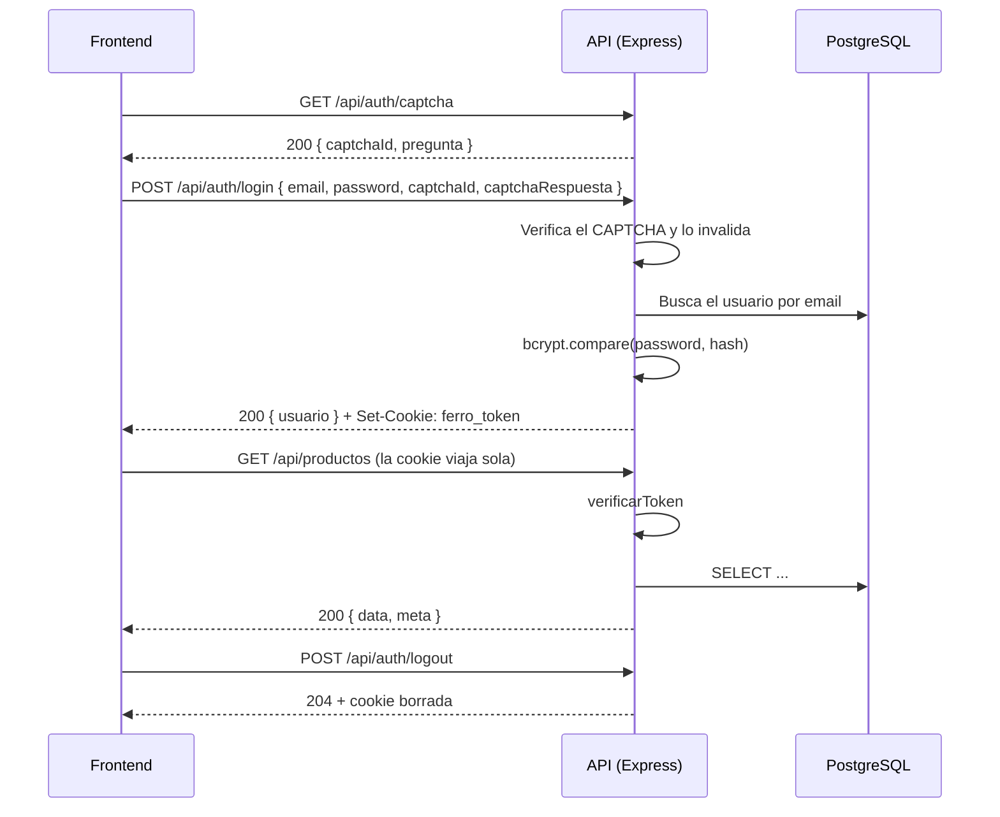

# 📑 Contrato de API y Arquitectura — FerroAdmin

> **Tarea:** T01 — Definir arquitectura y contrato de API
> **Versión:** 1.2 · **Autor:** Carlos Adrian Zapata · **Fecha:** 2026-11-17 (v1.1: 2026-11-13, v1.0: 2026-11-06)
> **Estado:** 🟡 En revisión. Ver [§10 Revisión del equipo](#10-revisión-del-equipo)

**Cambios en la v1.2:** el contrato se actualizó para que diga lo que está implementado y desplegado en Vercel (ver [§11](#11-segunda-fase-tareas-t21-a-t26)). Lo que difiere de la v1.1 y de la v1.0:

- Los endpoints nuevos son `PATCH /api/auth/password`, `POST /api/auth/recuperar`, `POST /api/auth/restablecer` y `GET /api/tareas/stock-bajo`. **No existe** `POST /api/productos/:id/imagen`: la imagen se envía al crear el producto (§11.2).
- El frontend usa rutas con `#` (`#/login`, `#/inventario`, `#/productos`, `#/recuperar`), no History API (§1.2).
- El CAPTCHA se guarda en la base de datos, en la tabla `captchas` (§4.4).
- Nuevo código de error `TOKEN_INVALIDO` (§3.3).
- Nuevo campo `imagenUrl` en el Producto, regla oficial de stock bajo (§11.3) y variables de entorno de producción (§11.1).
- La sección 7 pasó de "ajustes necesarios" a **estado de implementación**, con lo que falta.

Este documento es el acuerdo entre frontend y backend. Si el código no coincide con el contrato, se corrige el código o se actualiza el contrato mediante un PR, pero nunca uno solo de los dos.

---

## 1. Arquitectura general

```text
Navegador (SPA)  ──fetch /api/*──▶  Vite :5173  ──proxy──▶  Express :3000  ──pg──▶  PostgreSQL
                 ◀── JSON + cookie HttpOnly ──
```

- En desarrollo el navegador solo habla con Vite (`localhost:5173`), que reenvía `/api` al backend. Como frontend y API comparten origen, **la cookie de sesión se envía sola** y no hace falta CORS.
- En producción (Vercel) el frontend compilado y la API se publican en el mismo dominio (ver §1.3 y §11.1).

### 1.1 Backend (Express, ES Modules)

Recorrido de una petición: `routes → middlewares → controllers → services → config/db`

| Carpeta | Responsabilidad | Archivos previstos |
|---|---|---|
| `app.js` y `server.js` | `app.js` arma la aplicación (middlewares, rutas, 404 de API y manejador global de errores) y la exporta. `server.js` solo la enciende en local (`npm run dev`). Vercel usa `api/index.js`, que importa `app.js` (§11.1) | `app.js`, `server.js` |
| `routes/` | Declarar rutas y encadenar middlewares. Sin lógica. | `auth.js`, `productos.js`, `categorias.js`, `tareas.js` |
| `middlewares/` | Autenticación. | `authMiddleware.js` (`verificarToken`) |
| `controllers/` | Leer `req`, llamar al servicio y responder con el formato del §3. | `auth.js`, `captcha.js`, `cuenta.js`, `recuperacion.js`, `productos.js`, `categorias.js` |
| `services/` | Lógica de negocio y SQL. No conoce `req` ni `res`. | `auth.js`, `captcha.js`, `cuenta.js`, `recuperacion.js`, `correo.js`, `imagenes.js`, `stockBajo.js`, `productos.js`, `categorias.js` |
| `config/` | Conexión a la BD (`pg.Pool`). | `db.js` |
| `docs/` y `tests/` | Documentación Swagger (`/api/docs`, solo fuera de producción) y pruebas automáticas (`npm test`). Una prueba falla si una ruta de Express no está documentada, o al revés | `openapi.js`, `API_PRODUCTOS.md`, `*.test.js` |

Reglas:

- Todo SQL usa parámetros (`$1`, `$2`, …). Nunca se concatena texto que venga del usuario.
- Las columnas de la BD van en `snake_case` (`categoria_id`, `creado_en`) y los campos JSON en `camelCase` (`categoriaId`, `creadoEn`). La conversión se hace en `services/`.
- `pg` devuelve las columnas `NUMERIC` como texto: hay que convertir `precio` a `Number` antes de responder.

Dependencias principales (`backend/package.json`): `express`, `pg`, `dotenv`, `bcrypt`, `jsonwebtoken`, `cookie-parser`, `multer` (subida de imágenes), `nodemailer` (correos), `node-cron` (tarea programada local), `@vercel/functions` (`waitUntil`) y `swagger-ui-express` (documentación). `cors` sigue instalado pero no se usa: se puede quitar. `express-rate-limit` está previsto para el límite de intentos de login y todavía no se instaló.

Variables de entorno: la plantilla es `backend/.env.example` y la lista completa, con su significado, está en la tabla del §11.1. Para correr en local alcanzan `DATABASE_URL`, `JWT_SECRET` y `NODE_ENV`; las demás activan correos, imágenes y la tarea programada.

### 1.2 Frontend (SPA, Vanilla JS)

Una sola página (`index.html`) con un enrutador propio basado en el **hash de la dirección** (`#/login`, `#/inventario`, evento `hashchange`) en `js/app.js`. Se eligió el hash, y no History API, porque no necesita que el servidor devuelva `index.html` para cada ruta.

| Ruta | Vista | Acceso |
|---|---|---|
| `#/` | Redirige a `#/inventario` (con sesión) o a `#/login` (sin sesión) | — |
| `#/login` | Formulario de login + CAPTCHA | Pública (con sesión activa redirige a `#/inventario`) |
| `#/registro` | Formulario de registro + CAPTCHA | Pública |
| `#/recuperar` | Pedir el enlace para recuperar la clave + CAPTCHA | Pública |
| `#/restablecer?token=...` | Crear la clave nueva con el código del correo | Pública |
| `#/inventario` | Tabla, búsqueda, filtro y CRUD de productos | Requiere sesión |
| `#/productos` | Catálogo visual con las imágenes de los productos | Requiere sesión |
| Cualquier otra | **Página 404** con enlace para volver al inicio | — |

| Archivo | Responsabilidad |
|---|---|
| `js/app.js` | Enrutador, plantillas de login y registro, y vista 404 |
| `js/api.js` | Función única para llamar a la API: envía y recibe JSON, interpreta los errores del §3.2 y redirige a `#/login` ante un 401 en rutas protegidas |
| `js/auth.js` | Sesión (`GET /api/auth/me`), envío de login y registro, y cierre de sesión |
| `js/validaciones.js` | Validaciones de los formularios y marcado de errores bajo cada campo |
| `js/captcha.js` | Pedir y mostrar el desafío (`GET /api/auth/captcha`) |
| `js/recuperacion.js` | Pantallas de recuperar y restablecer la clave |
| `js/inventario.js` | Tabla de inventario y catálogo de productos: búsqueda en tiempo real, filtro, paginación y formularios de crear, editar, ajustar stock y eliminar |
| `js/cuenta.js` | Menú del nombre de usuario y ventana para cambiar la contraseña (§11.5) |

- El JavaScript **no puede leer la cookie** (es `HttpOnly`). Para saber si hay sesión se llama a `GET /api/auth/me`.
- Búsqueda en tiempo real: esperar unos 300 ms después de la última tecla (debounce) antes de llamar a la API.
- La página 404 la muestra el frontend. El 404 de la API es JSON (§3.2). En desarrollo, Vite ya devuelve `index.html` para cualquier ruta desconocida, así que el enrutador decide.

### 1.3 Producción

`vite build` genera el frontend en `frontend/dist`. Vercel lo sirve como archivos estáticos y reenvía `/api/*` a Express (§11.1). Express **no** sirve el frontend. Como las rutas del frontend usan `#`, el servidor nunca recibe una ruta como `/login`, así que no hace falta devolver `index.html` para rutas desconocidas.

### 1.4 Paleta de colores

Todos los colores del frontend salen de estas variables CSS, declaradas una sola vez en el bloque `:root` de `frontend/src/css/tokens.css`. Las hojas de estilo no usan códigos hexadecimales sueltos.

| Variable | Color | Hex | Uso |
|---|---|---|---|
| `--color-primario` | Azul oscuro | `#172B4D` | Barra superior, botones principales, títulos y texto principal |
| `--color-acento` | Ámbar | `#F59E0B` | Elemento activo o seleccionado, resaltados y acción destacada (por ejemplo, "Nuevo producto") |
| `--color-fondo` | Fondo | `#F8FAFC` | Fondo general de la página |
| `--color-tarjeta` | Tarjetas | `#FFFFFF` | Tarjetas, tabla de productos, formularios y ventanas modales |
| `--color-exito` | Éxito | `#16A34A` | Confirmaciones: producto creado o actualizado, registro exitoso |
| `--color-error` | Error | `#DC2626` | Mensajes de error (incluidos los `#error-<campo>` del §3.2) y botón Eliminar |

```css
:root {
  --color-primario: #172B4D;
  --color-acento: #F59E0B;
  --color-fondo: #F8FAFC;
  --color-tarjeta: #FFFFFF;
  --color-exito: #16A34A;
  --color-error: #DC2626;
}
```

Contraste (WCAG AA pide 4.5:1 para texto normal y 3:1 para texto grande, es decir 24 px, o 19 px en negrita):

| Combinación | Contraste | Uso |
|---|---|---|
| Azul oscuro sobre tarjeta, o blanco sobre azul oscuro | 14.1:1 | Cualquier texto |
| Azul oscuro sobre fondo | 13.5:1 | Cualquier texto |
| Azul oscuro sobre ámbar | 6.6:1 | Texto de botones y etiquetas ámbar |
| Blanco sobre ámbar | 2.2:1 | ❌ No usar: el texto sobre ámbar va en azul oscuro |
| Blanco sobre error, o error sobre tarjeta | 4.8:1 | Cualquier texto |
| Blanco sobre éxito, o éxito sobre tarjeta | 3.3:1 | Solo texto grande o en negrita, o acompañado de un ícono. Para texto normal usar `--color-exito-texto` |

La paleta no incluye ningún gris. El texto secundario, los bordes, los estados hover y las versiones oscuras para texto (`--color-texto-suave`, `--color-borde`, `--color-exito-texto`, `--color-error-texto`, etc.) se **derivan** de estos 6 colores con `color-mix()` en `frontend/src/css/tokens.css`. Todos los detalles, componentes y reglas están en `GUIA_VISUAL.md`.

---

## 2. Convenciones generales

- Prefijo de todas las rutas: `/api`. Cuerpos en JSON (`Content-Type: application/json`), UTF-8.
- Campos en `camelCase` y en español, salvo `email` y `password`, que ya usa el formulario de login.
- IDs: enteros positivos autoincrementales.
- Fechas: ISO 8601 en UTC, por ejemplo `"2026-11-06T15:30:00.000Z"`.
- Dinero: `precio` es un número con hasta 2 decimales (`28500` o `28500.5`).
- Textos: el backend aplica `trim()` antes de validar.

---

## 3. Formato de respuestas

### 3.1 Éxito

Un recurso:

```json
{ "data": { "id": 15, "nombre": "Martillo de uña 16 oz" } }
```

Una lista:

```json
{
  "data": [],
  "meta": { "total": 42, "pagina": 1, "limite": 20, "totalPaginas": 3 }
}
```

`204 No Content` no lleva cuerpo.

### 3.2 Error (siempre con esta forma)

```json
{
  "error": {
    "codigo": "VALIDACION",
    "mensaje": "Hay campos con errores",
    "detalles": [
      { "campo": "precio", "mensaje": "Debe ser un número mayor o igual a 0" }
    ]
  }
}
```

- `codigo`: constante con la que el frontend decide qué hacer.
- `mensaje`: texto en español que se puede mostrar al usuario.
- `detalles`: solo en errores de validación. `campo` coincide con el `name` del input, así que el frontend puede mostrarlo en `#error-<campo>` (como ya hace el login con `#error-email` y `#error-password`).
- Nunca se envían trazas (stack) ni mensajes internos de PostgreSQL.

### 3.3 Códigos HTTP y de error

| HTTP | `codigo` | Cuándo |
|---|---|---|
| 200 OK | — | Lectura o actualización correcta |
| 201 Created | — | Recurso creado |
| 204 No Content | — | Eliminación o logout |
| 400 Bad Request | `VALIDACION` | Campos faltantes o inválidos, JSON mal formado, id no numérico, parámetros de búsqueda inválidos |
| 400 Bad Request | `CAPTCHA_INVALIDO` | Respuesta incorrecta, CAPTCHA expirado o ya usado |
| 400 Bad Request | `TOKEN_INVALIDO` | El código del correo de recuperación no existe, ya se usó o venció (30 minutos) |
| 401 Unauthorized | `NO_AUTENTICADO` | Sin cookie, o token inválido o expirado |
| 401 Unauthorized | `CREDENCIALES_INVALIDAS` | Correo o clave incorrectos (mismo mensaje en ambos casos) |
| 404 Not Found | `NO_ENCONTRADO` | El recurso o la ruta de API no existen |
| 409 Conflict | `CONFLICTO` | Correo ya registrado o nombre de producto repetido |
| 409 Conflict | `STOCK_INSUFICIENTE` | Un ajuste dejaría el stock en negativo |
| 429 Too Many Requests | `DEMASIADOS_INTENTOS` | Límite de intentos de login superado (con cabecera `Retry-After`) |
| 500 Internal Server Error | `ERROR_INTERNO` | Error no controlado |

---

## 4. Autenticación

### 4.1 Mecanismo

- JWT firmado con `JWT_SECRET` (HS256), con duración `JWT_EXPIRA` (8 h, una jornada). Payload: `{ "sub": 7 }` (id del usuario) más `iat` y `exp`.
- El token se entrega en una cookie, nunca en el cuerpo de la respuesta:

  ```http
  Set-Cookie: ferro_token=<jwt>; HttpOnly; SameSite=Strict; Path=/; Max-Age=28800
  ```

  En producción se agrega `Secure`.
- `HttpOnly` impide que un script malicioso robe el token (XSS). `SameSite=Strict` impide que otro sitio haga peticiones con la cookie del usuario (CSRF).
- Contraseñas: `bcrypt` con costo 10. Solo se guarda el hash.
- No hay refresh token. Cuando el token expira, la API responde 401 y el frontend lleva a `/login`.

### 4.2 Flujo



Orden de verificación en el login: (1) validar campos, (2) CAPTCHA, (3) credenciales. Así, un bot que no resuelve el CAPTCHA no llega a probar contraseñas.

### 4.3 Middleware de protección

- `verificarToken`: lee `req.cookies.ferro_token`, verifica el JWT y deja `req.usuario = { id }`. Si falla responde 401 `NO_AUTENTICADO`.
- No hay roles: cualquier usuario con sesión puede hacer todas las operaciones del inventario.

### 4.4 CAPTCHA (desafío matemático, tarea T07)

- El servidor genera la operación (por ejemplo `7 + 4`) y guarda la respuesta en la tabla `captchas` (§6) asociada a un `captchaId`, con expiración de 5 minutos. Se guarda en la base y no en memoria porque en Vercel cada petición puede atenderla una copia distinta del servidor (§11.1).
- Cada CAPTCHA **sirve una sola vez**: se borra al verificarlo, sea correcto o no. Después de cualquier intento fallido, el frontend pide uno nuevo.
- La respuesta nunca viaja al frontend. Validar el CAPTCHA en el navegador no protege de nada.

---

## 5. Endpoints

| Método | Ruta | Acceso | Descripción |
|---|---|---|---|
| GET | `/api/health` | Pública | Estado del servidor |
| GET | `/api/auth/captcha` | Pública | Nuevo desafío anti-bot |
| POST | `/api/auth/registro` | Pública | Crear cuenta |
| POST | `/api/auth/login` | Pública | Iniciar sesión |
| POST | `/api/auth/logout` | Pública* | Cerrar sesión |
| GET | `/api/auth/me` | Sesión | Usuario de la sesión actual |
| POST | `/api/auth/recuperar` | Pública | Pedir el correo para recuperar la clave |
| POST | `/api/auth/restablecer` | Pública | Crear la clave nueva con el código del correo |
| PATCH | `/api/auth/password` | Sesión | Cambiar la contraseña (§11.5, T25) |
| GET | `/api/categorias` | Sesión | Listar categorías |
| GET | `/api/productos` | Sesión | Listar, buscar y filtrar |
| GET | `/api/productos/:id` | Sesión | Detalle de un producto |
| POST | `/api/productos` | Sesión | Crear producto, con imagen opcional por URL o como archivo (§11.2) |
| PUT | `/api/productos/:id` | Sesión | Actualizar producto (completo) |
| PATCH | `/api/productos/:id/stock` | Sesión | Sumar o restar stock |
| DELETE | `/api/productos/:id` | Sesión | Eliminar producto |
| GET | `/api/tareas/stock-bajo` | Secreto del cron | Revisar el stock bajo (§11.3, T24) |

\* El logout responde 204 aunque no haya sesión, para que siempre pueda limpiar la cookie.

### 5.1 Objetos de salida

**Usuario** (nunca incluye la contraseña ni su hash)

```json
{
  "id": 7,
  "nombre": "Ana Gómez",
  "email": "ana@ejemplo.com",
  "creadoEn": "2026-11-06T15:30:00.000Z"
}
```

**Categoría**

```json
{ "id": 2, "nombre": "Herramientas manuales" }
```

**Producto**

```json
{
  "id": 15,
  "nombre": "Martillo de uña 16 oz",
  "categoria": { "id": 2, "nombre": "Herramientas manuales" },
  "precio": 28500,
  "stock": 12,
  "imagenUrl": "https://xyz.supabase.co/storage/v1/object/public/productos/15.webp",
  "creadoEn": "2026-11-06T15:30:00.000Z",
  "actualizadoEn": "2026-11-06T15:30:00.000Z"
}
```

`imagenUrl` (v1.1) es `null` cuando el producto no tiene imagen.

### 5.2 Reglas de validación de entrada

| Campo | Tipo | Reglas |
|---|---|---|
| `nombre` (usuario) | string | Obligatorio, 2 a 100 caracteres |
| `email` | string | Obligatorio, formato de correo, máximo 150 caracteres, se guarda en minúsculas, único |
| `password` | string | Registro: 8 a 72 caracteres (72 es el límite de bcrypt). Login: solo que no esté vacío |
| `captchaId` | string | Obligatorio |
| `captchaRespuesta` | integer | Obligatorio (el frontend lo convierte con `Number()` antes de enviarlo) |
| `nombre` (producto) | string | Obligatorio, 2 a 120 caracteres, único sin distinguir mayúsculas |
| `categoriaId` | integer | Obligatorio, debe existir en `categorias` |
| `precio` | number | Obligatorio, mayor o igual a 0, máximo 2 decimales |
| `stock` | integer | Obligatorio, mayor o igual a 0 |
| `cantidad` (ajuste de stock) | integer | Obligatorio, distinto de 0 (positivo suma, negativo resta) |
| `imagenUrl` | string \| null | Opcional en `POST /api/productos` (el `PUT` la ignora). Si viene, debe empezar por `http://` o `https://` y tener máximo 2048 caracteres. No se puede enviar junto con un archivo `imagen` |
| `imagen` (archivo) | JPEG, PNG o WebP | Opcional en `POST /api/productos` con `multipart/form-data`. Máximo 4 MB. Se revisa el contenido real del archivo |
| `token` (recuperación) | string | Obligatorio en `POST /api/auth/restablecer`: el código que llegó en el enlace del correo |
| `claveActual` (v1.1) | string | Obligatorio en el cambio de contraseña, no vacío |
| `claveNueva` (v1.1) | string | Obligatorio, 8 a 72 caracteres y distinta de `claveActual` |

Los campos que genera el servidor (`id`, `creadoEn`, `actualizadoEn`) se ignoran si vienen en el cuerpo.

### 5.3 Autenticación

#### `GET /api/auth/captcha`

`200 OK`

```json
{
  "data": {
    "captchaId": "b3f1c2e4-9a7d-4c1e-8f2a-1d2e3f4a5b6c",
    "pregunta": "¿Cuánto es 7 + 4?",
    "expiraEnSegundos": 300
  }
}
```

#### `POST /api/auth/registro`

Entrada:

```json
{
  "nombre": "Ana Gómez",
  "email": "ana@ejemplo.com",
  "password": "Clave1234",
  "captchaId": "b3f1c2e4-9a7d-4c1e-8f2a-1d2e3f4a5b6c",
  "captchaRespuesta": 11
}
```

`201 Created`: `{ "data": <Usuario> }`. El registro **no** inicia sesión; el frontend redirige a `/login` con un mensaje de éxito.

Errores: `400 VALIDACION`, `400 CAPTCHA_INVALIDO`, `409 CONFLICTO` (correo ya registrado).

#### `POST /api/auth/login`

Entrada:

```json
{
  "email": "ana@ejemplo.com",
  "password": "Clave1234",
  "captchaId": "b3f1c2e4-9a7d-4c1e-8f2a-1d2e3f4a5b6c",
  "captchaRespuesta": 11
}
```

`200 OK`: `{ "data": <Usuario> }` + cabecera `Set-Cookie` (§4.1).

Errores: `400 VALIDACION`, `400 CAPTCHA_INVALIDO`, `401 CREDENCIALES_INVALIDAS` (mensaje: "Correo o clave incorrectos"), `429 DEMASIADOS_INTENTOS` (5 intentos fallidos por IP en 15 minutos; **pendiente de implementar**, ver §7).

#### `POST /api/auth/logout`

Sin cuerpo. `204 No Content` + `Set-Cookie: ferro_token=; Path=/; Max-Age=0`.

#### `GET /api/auth/me`

`200 OK`: `{ "data": <Usuario> }`

Errores: `401 NO_AUTENTICADO` (también si el usuario del token ya no existe).

#### `POST /api/auth/recuperar`

Entrada:

```json
{
  "email": "ana@ejemplo.com",
  "captchaId": "b3f1c2e4-9a7d-4c1e-8f2a-1d2e3f4a5b6c",
  "captchaRespuesta": 11
}
```

`200 OK`, **siempre con el mismo mensaje, exista o no el correo**, para no revelar quién tiene cuenta:

```json
{ "data": { "mensaje": "Si el correo está registrado, te enviamos un enlace para crear una clave nueva." } }
```

Si el correo existe, se le envía un enlace con un código que vence a los 30 minutos (§11.6). Pedir uno nuevo anula los anteriores.

Errores: `400 VALIDACION` (falta el correo), `400 CAPTCHA_INVALIDO`.

#### `POST /api/auth/restablecer`

Entrada: el código del enlace y la clave nueva (8 a 72 caracteres).

```json
{ "token": "<código del enlace del correo>", "password": "ClaveNueva123" }
```

`200 OK`: `{ "data": { "mensaje": "Tu clave fue cambiada. Ya puedes iniciar sesión." } }`. No inicia sesión.

Errores: `400 VALIDACION` (faltan campos o la clave no tiene entre 8 y 72 caracteres), `400 TOKEN_INVALIDO` (el código no existe, ya se usó o venció).

#### `PATCH /api/auth/password`

Cambiar la contraseña con la sesión abierta. Ver §11.5.

### 5.4 Categorías

#### `GET /api/categorias`

`200 OK`, ordenadas por nombre y sin paginación (es una lista corta que llena el `<select>` del formulario y el filtro):

```json
{
  "data": [
    { "id": 1, "nombre": "Eléctricos" },
    { "id": 2, "nombre": "Herramientas manuales" },
    { "id": 3, "nombre": "Plomería" }
  ]
}
```

Las categorías se cargan con el script de semilla. En esta versión no hay CRUD de categorías.

### 5.5 Productos

#### `GET /api/productos`

Parámetros de consulta (todos opcionales):

| Parámetro | Tipo | Por defecto | Descripción |
|---|---|---|---|
| `buscar` | string | — | Coincidencia parcial en `nombre`, sin distinguir mayúsculas. Máximo 100 caracteres |
| `categoriaId` | integer | — | Filtrar por categoría |
| `pagina` | integer ≥ 1 | `1` | Página solicitada |
| `limite` | integer 1–100 | `20` | Productos por página |
| `orden` | `nombre` \| `precio` \| `stock` \| `creadoEn` | `nombre` | Campo de ordenamiento |
| `direccion` | `asc` \| `desc` | `asc` | Sentido del ordenamiento |

Ejemplo: `GET /api/productos?buscar=mart&categoriaId=2&pagina=1&limite=20`

`200 OK`

```json
{
  "data": [
    {
      "id": 15,
      "nombre": "Martillo de uña 16 oz",
      "categoria": { "id": 2, "nombre": "Herramientas manuales" },
      "precio": 28500,
      "stock": 12,
      "creadoEn": "2026-11-06T15:30:00.000Z",
      "actualizadoEn": "2026-11-06T15:30:00.000Z"
    }
  ],
  "meta": { "total": 1, "pagina": 1, "limite": 20, "totalPaginas": 1 }
}
```

Si no hay resultados se responde `200` con `"data": []` y `"total": 0` (no es un 404).

Errores: `400 VALIDACION` (parámetro inválido), `401 NO_AUTENTICADO`.

Notas para el backend:

- `orden` se valida contra una lista fija de columnas, porque los nombres de columna no se pueden pasar como parámetro `$1`.
- Escapar `%` y `_` en el texto de `buscar` antes de usarlo en `ILIKE`.
- Para que la búsqueda sea eficiente se recomienda un índice trigram: `CREATE EXTENSION pg_trgm;` y `CREATE INDEX idx_productos_nombre_trgm ON productos USING gin (nombre gin_trgm_ops);`.

#### `GET /api/productos/:id`

`200 OK`: `{ "data": <Producto> }`

Errores: `400 VALIDACION` (id no válido), `401`, `404 NO_ENCONTRADO`.

#### `POST /api/productos`

Entrada:

```json
{ "nombre": "Martillo de uña 16 oz", "categoriaId": 2, "precio": 28500, "stock": 12 }
```

`201 Created`: `{ "data": <Producto> }`

La imagen es opcional (campo `imagenUrl` en JSON, o archivo `imagen` en `multipart/form-data`; ver §11.2).

Errores: `400 VALIDACION`, `401`, `409 CONFLICTO` (ya existe un producto con ese nombre).

#### `PUT /api/productos/:id`

Entrada: los mismos 4 campos de `POST`, todos obligatorios (reemplazo completo).

`200 OK`: `{ "data": <Producto> }` con `actualizadoEn` renovado.

Errores: `400 VALIDACION`, `401`, `404 NO_ENCONTRADO`, `409 CONFLICTO`.

#### `PATCH /api/productos/:id/stock`

Registra entradas y salidas de mercancía sin editar el resto del producto.

Entrada:

```json
{ "cantidad": -3 }
```

`200 OK`: `{ "data": <Producto> }` con el stock actualizado.

Errores: `400 VALIDACION`, `401`, `404 NO_ENCONTRADO`, `409 STOCK_INSUFICIENTE`.

Se resuelve en una sola consulta atómica, para que dos usuarios que venden la última unidad al mismo tiempo no dejen el stock en negativo:

```sql
UPDATE productos
SET stock = stock + $1, actualizado_en = now()
WHERE id = $2 AND stock + $1 >= 0
RETURNING *;
```

Si no se actualiza ninguna fila, se comprueba si el producto existe para responder `404` o `409`.

#### `DELETE /api/productos/:id`

`204 No Content`

Errores: `400 VALIDACION`, `401`, `404 NO_ENCONTRADO`.

### 5.6 Health

`GET /api/health` responde `200 { "status": "ok" }`. Se usa para comprobar que el servidor responde (por ejemplo con `curl`); es la única respuesta que no va dentro de `data`.

---

## 6. Modelo de datos de referencia

| Tabla | Columnas |
|---|---|
La fuente de verdad del esquema es `backend/sql/setup.sql`. Esta tabla resume lo que usa la API.

| Tabla | Columnas |
|---|---|
| `usuarios` | `id SERIAL PK`, `nombre VARCHAR(100)`, `email VARCHAR(150) UNIQUE`, `password_hash TEXT`, `rol VARCHAR(50) DEFAULT 'Operador'` (la API no lo usa: no hay roles), `creado_en TIMESTAMPTZ DEFAULT now()` |
| `categorias` | `id SERIAL PK`, `nombre VARCHAR(60) UNIQUE` |
| `productos` | `id SERIAL PK`, `nombre VARCHAR(120)`, `descripcion TEXT` (la API no la usa todavía), `imagen_url TEXT NULL`, `categoria_id INT REFERENCES categorias`, `precio NUMERIC(12,2) CHECK (precio >= 0)`, `stock INT CHECK (stock >= 0)`, `creado_en TIMESTAMPTZ DEFAULT now()`, `actualizado_en TIMESTAMPTZ DEFAULT now()`. Índice único sobre `lower(nombre)` e índice trigram (`pg_trgm`) sobre `nombre` para la búsqueda |
| `movimientos_inventario` | `id`, `producto_id`, `usuario_id`, `tipo_movimiento` (`ENTRADA`, `SALIDA`, `AJUSTE`), `cantidad`, `motivo`, `creado_en`. La API todavía no la usa: el ajuste de stock (§5.5) no registra movimientos |
| `tokens_recuperacion` | `id`, `usuario_id`, `token_hash TEXT UNIQUE` (solo el hash, nunca el código), `vence_en`, `usado`, `creado_en`. Ver §11.6 |
| `captchas` | `id UUID PK`, `respuesta INT NOT NULL`, `vence TIMESTAMPTZ NOT NULL`. Ver §4.4 |

---

## 7. Estado de implementación

Qué del contrato ya está en el código y qué falta. Se actualiza cuando cambia algo.

| # | Tema | Estado | Detalle |
|---|---|---|---|
| 1 | Conexión a PostgreSQL con `pg` (T09) | ✅ Hecho | `config/db.js`, con SSL opcional y pool de 3 conexiones |
| 2 | 404 de la API y manejador global de errores en el formato del §3.2 | ✅ Hecho | En `backend/app.js` |
| 3 | Frontend sin colores sueltos | ✅ Hecho | Las variables están en `css/tokens.css` (§1.4) |
| 4 | Build del frontend en `frontend/dist` | ✅ Hecho | `vite.config.js` |
| 5 | Variables de entorno de ejemplo | ✅ Hecho | `backend/.env.example` |
| 6 | CRUD de productos, búsqueda, filtro y paginación (T13, T14, T15) | ✅ Hecho | Con pruebas automáticas y documentación Swagger |
| 7 | Registro, login, logout y sesión con cookie HttpOnly (T10, T11) | ✅ Hecho | |
| 8 | CAPTCHA en login, registro y recuperación (T07) | ✅ Hecho | Guardado en la base (§4.4) |
| 9 | Recuperar clave y correos de bienvenida y de aviso (T21) | ✅ Hecho | §11.6 |
| 10 | Imágenes de productos (T22) | ✅ Hecho | §11.2 |
| 11 | Deploy en Vercel y base en Supabase (T23, T26) | ✅ Hecho | §11.1 y §11.4 |
| 12 | Cambiar contraseña (T25) | ✅ Hecho | §11.5 |
| 13 | **Validación de los datos del registro en el servidor** (§5.2) | ❌ Pendiente | Hoy el servidor solo comprueba que los campos vengan. Acepta nombre de 1 letra, correo mal escrito y clave de 1 carácter; solo el navegador valida |
| 14 | **Límite de intentos de login** (`429 DEMASIADOS_INTENTOS`, §5.3) | ❌ Pendiente | `express-rate-limit` no está instalado. En Vercel el contador debe guardarse en la base (§11.1) |
| 15 | **Correo de stock bajo** (T24, §11.3) | 🟡 En progreso | La tarea programada existe pero solo escribe en los logs |
| 16 | **README** con instalación y demostración (T20) | 🟡 En progreso | `README.md` en la raíz |
| 17 | Quitar la dependencia `cors`, que no se usa | ⚪ Menor | `backend/package.json` |
| 18 | Unificar `sql/migraciones/` y `sql/migrations/` | ⚪ Menor | Dejar una sola carpeta |
| 19 | Registrar movimientos de inventario | ⚪ Menor | La tabla `movimientos_inventario` existe, pero el ajuste de stock no escribe en ella |

---

## 8. Decisiones para confirmar en la revisión

Ya están incluidas en el contrato. Si alguien no está de acuerdo, se discute en el PR:

1. **`PATCH /api/productos/:id/stock`.** Es la interpretación de "autosuma" en la especificación: entradas y salidas de mercancía sin editar el producto completo.
2. **CAPTCHA también en el registro.** La especificación solo lo pide en el login; se reutiliza el mismo componente.
3. **Desafío matemático propio en lugar de reCAPTCHA.** No requiere claves ni conexión a Google. Si el equipo prefiere reCAPTCHA, solo cambian `captchaId` y `captchaRespuesta` por un único `captchaToken`.
4. **Nombre de producto único.** Evita duplicados como "Martillo" y "martillo".
5. **El registro no inicia sesión.** Después de registrarse, el usuario va al login.

**Fuera de alcance:** roles y permisos. Como es un ejercicio académico, todos los usuarios con sesión tienen los mismos permisos.

---

## 9. Cómo se cambia este contrato

- Todo cambio se hace con un PR que modifique este archivo, antes o junto con el código.
- Un cambio que rompe compatibilidad (renombrar o quitar campos, cambiar códigos) sube la versión mayor (2.0). Agregar campos opcionales sube la menor (1.1).

---

## 10. Revisión del equipo

Cada integrante revisa el PR de este documento y lo aprueba o deja comentarios. Quien trabaje en frontend revisa sobre todo los campos, los formatos de error y las rutas de la SPA; quien trabaje en backend revisa que los endpoints, validaciones y consultas sean viables.

- [x] Carlos Adrian Zapata (autor)
- [ ] Rafaela Martinez Jimenez
- [ ] Aaron Medina
- [ ] Andres Lozano

La v1.2 cambió bastante respecto a la que revisaron (el contrato ahora describe lo implementado, §7 y §11). Necesita una nueva revisión de todo el equipo, en especial de los responsables de cada tarea: Rafaela (T07, T21), Aaron (T22, T24) y Andrés (T13, T14, T15, T23). Al aprobar, marcar la casilla y, cuando estén las cuatro, cambiar el estado del encabezado a "Aprobado".

---

## 11. Segunda fase (tareas T21 a T26)

| Tarea | Responsable | Resumen | Estado | Sección |
|---|---|---|---|---|
| T21 Mejorar login | Rafaela | Recuperar clave por correo y correo de bienvenida | Hecho | §11.6 |
| T22 Componente nuevo Productos | Aaron | Ver productos con su imagen; la imagen se carga por URL o desde el computador | Hecho | §11.2 |
| T23 Deployar | Carlos y Andrés | Publicar el proyecto en Vercel | Hecho | §11.1 |
| T24 Envío de correo con stock bajo | Aaron | Tarea programada que revisa el stock bajo dos veces al día y envía un correo | **En progreso** (falta el correo) | §11.3 |
| T25 Cambiar contraseña desde el panel principal | Carlos | El usuario con sesión cambia su contraseña | Hecho | §11.5 |
| T26 BD externa | Carlos | Usar una base de datos en la nube (Supabase) en lugar de la local | Hecho | §11.4 |

### 11.1 Deploy en Vercel (T23) · hecho

```text
Navegador ──▶ Vercel ──┬── archivos estáticos (frontend/dist)
                       └── /api/* ──▶ Express como función ──pg──▶ PostgreSQL en Supabase (§11.4)
```

- Frontend y API se publican en **el mismo dominio** de Vercel, igual que en desarrollo con el proxy de Vite. Así la cookie `SameSite=Strict` sigue funcionando y no hace falta CORS.
- La configuración está en `vercel.json` (raíz): instala `backend/` y `frontend/`, compila con `vite build` hacia `frontend/dist`, reenvía `/api/*` a la función y declara los dos crons (§11.3). `api/index.js` exporta la app Express.
- La app Express vive en `backend/app.js` y no enciende el servidor. `backend/server.js` solo se usa en local: comprueba la base, programa la tarea de stock bajo con `node-cron` y llama a `app.listen`.
- En producción `NODE_ENV=production`: la cookie lleva `Secure` y Swagger (`/api/docs`) no se publica.

**Implicaciones de usar funciones de Vercel** (el servidor no queda encendido todo el tiempo: cada petición puede atenderla una copia distinta):

| Qué | Problema | Solución | Estado |
|---|---|---|---|
| CAPTCHA | La memoria no se comparte entre copias | Tabla `captchas` (§6): un solo uso y 5 minutos | Hecho |
| Imágenes subidas | Los archivos del servidor se pierden | Supabase Storage (§11.2) | Hecho |
| Tarea programada | No hay un proceso encendido con temporizador | Vercel Cron llama a un endpoint (§11.3) | Hecho; el correo falta (T24) |
| Correos | Vercel congela la función al responder y el envío se cortaba | `waitUntil` de `@vercel/functions` mantiene viva la función hasta que el correo sale | Hecho |
| Límite de intentos de login (§5.3) | Un contador en memoria no se comparte | Contar los intentos en la base de datos | **Pendiente** |

Variables de entorno (se configuran en Vercel y en `backend/.env`, nunca en el repositorio; la plantilla es `backend/.env.example`):

| Variable | Obligatoria | Qué es |
|---|---|---|
| `DATABASE_URL` | Sí | Conexión a PostgreSQL. En Supabase, la del *Transaction pooler* (puerto 6543), sin `sslmode` |
| `DATABASE_SSL` | En Supabase | `true` para activar SSL. En local se deja vacía |
| `JWT_SECRET` | Sí | Secreto para firmar la sesión. Uno distinto en cada entorno |
| `JWT_EXPIRA` | No (`8h`) | Duración de la sesión |
| `NODE_ENV` | Sí | `development` o `production` |
| `PORT` | No (`3000`) | Puerto local. Vercel lo ignora |
| `SMTP_HOST`, `SMTP_PORT`, `SMTP_USER`, `SMTP_PASS` | Para enviar correos | Servidor de correo (Gmail con contraseña de aplicación, o Ethereal en pruebas) |
| `FRONTEND_URL` | No | Dirección pública para los enlaces de los correos. Ver §11.6 |
| `SUPABASE_URL`, `SUPABASE_SERVICE_ROLE_KEY`, `SUPABASE_STORAGE_BUCKET` | Para subir imágenes | Proyecto, llave de servicio (solo en el servidor) y bucket (`productos`, público) |
| `CRON_SECRET` | En Vercel | Secreto que Vercel Cron envía a `/api/tareas/stock-bajo` |

### 11.2 Imágenes de productos (T22) · hecho

- El objeto Producto tiene el campo `imagenUrl` (`null` si no tiene). La tabla tiene la columna `imagen_url` (§6).
- **No existe** un endpoint aparte para subir la imagen. La imagen se envía al **crear** el producto con `POST /api/productos`, de una de dos formas (nunca las dos a la vez):
  - **Como URL**, en JSON: `imagenUrl` con una dirección `http` o `https` de máximo 2048 caracteres.
  - **Como archivo**, en `multipart/form-data`: el campo `imagen` (JPEG, PNG o WebP, máximo **4 MB**; Vercel acepta como máximo 4,5 MB por petición) junto con los demás campos como texto. El servidor revisa el contenido real del archivo, lo guarda en Supabase Storage y guarda su URL pública.
- `PUT /api/productos/:id` no cambia la imagen: ignora `imagenUrl` y el producto conserva la que tenía.
- Errores de la imagen: `400 VALIDACION` (URL inválida, archivo que no es una imagen permitida, más de 4 MB, o URL y archivo juntos) y `500 ERROR_INTERNO` si Supabase Storage rechaza la subida.
- Frontend: `#/productos` es el catálogo visual con las imágenes; `#/inventario` es la tabla. Las dos comparten la misma vista (`inventario.js`).

### 11.3 Correo de stock bajo (T24) · en progreso

**Regla oficial de stock bajo:** un producto tiene stock bajo cuando tiene **entre 1 y 5 unidades**. Con 0 unidades está **agotado**. Es la misma regla que usa la tabla del inventario (`STOCK_BAJO = 5` en `frontend/src/js/inventario.js`); si cambia, se cambia aquí y en el código a la vez.

#### `GET /api/tareas/stock-bajo`

Lo llama Vercel Cron dos veces al día, a las 8:00 y a las 16:00 hora de Colombia (`0 13 * * *` y `0 21 * * *` en UTC, porque Vercel usa UTC; ver `vercel.json`). En el plan gratuito de Vercel cada cron puede ejecutarse como máximo una vez al día, con margen de hasta una hora. No se llama desde el frontend. En local, `server.js` programa la misma revisión con `node-cron`.

- Acceso: cabecera `Authorization: Bearer <CRON_SECRET>`. Sin ella, o sin `CRON_SECRET` configurado, responde `401 NO_AUTENTICADO`.
- **Hoy** revisa los productos con `stock BETWEEN 1 AND 5` y los **registra en los logs**. Responde `200 { "data": { "stockBajo": <cantidad> } }`.
- **Falta (T24):** enviar un correo con dos listas, stock bajo y agotados (nombre y unidades), a una dirección configurable (variable propuesta: `ALERTA_STOCK_PARA`), y no enviarlo si no hay productos. Cuando exista, la respuesta incluirá `agotados` y `correoEnviado`:

```json
{ "data": { "stockBajo": 3, "agotados": 1, "correoEnviado": true } }
```

Errores: `401 NO_AUTENTICADO`, `500 ERROR_INTERNO`.

### 11.4 Base de datos externa (T26) · hecho

- Se usa PostgreSQL en Supabase. No cambia el código de las consultas: solo la `DATABASE_URL`.
- `config/db.js` activa SSL cuando `DATABASE_SSL=true` (Supabase lo exige) y usa un pool de 3 conexiones.
- **Conexión desde Vercel:** se usa el *Transaction pooler* de Supabase (puerto 6543), con el usuario `postgres.<código del proyecto>`. La conexión directa (`db.<proyecto>.supabase.co`) no funciona desde Vercel porque requiere IPv6.
- Las tablas se crean ejecutando `sql/setup.sql` y después `sql/seed.sql`. `setup.sql` **borra y recrea** todas las tablas. Las extensiones `uuid-ossp` y `pg_trgm` están disponibles en Supabase.
- Para agregar tablas o columnas sin borrar datos, los cambios van como archivos en `sql/migraciones/`. (Hoy también existe `sql/migrations/`; conviene unificarlas.)
- La base local se sigue usando para desarrollar. Cada integrante decide con su `.env` a cuál se conecta.
- Al cargar los `.sql` desde PowerShell hay que fijar la codificación antes, o las tildes se guardan mal: `$env:PGCLIENTENCODING="UTF8"`.

### 11.5 Cambiar contraseña (T25)

Interfaz: en el encabezado del inventario, al hacer clic en el nombre del usuario se despliega un menú con la opción **Cambiar contraseña**. Esa opción abre una ventana modal con tres campos: contraseña actual, contraseña nueva y repetir contraseña nueva. Al guardar, el frontend envía la contraseña actual y la nueva. El campo "repetir contraseña nueva" solo sirve para que el navegador compruebe que la persona escribió bien la nueva; por eso no se envía al servidor.

#### `PATCH /api/auth/password`

Entrada:

```json
{ "claveActual": "Clave1234", "claveNueva": "OtraClave5678" }
```

`200 OK`: `{ "data": <Usuario> }`. **La sesión sigue abierta**: no se pide iniciar sesión de nuevo.

Errores:

- `400 VALIDACION` cuando falta un campo, la nueva no cumple §5.2 o es igual a la actual.
- `400 VALIDACION` cuando la contraseña actual es incorrecta, con `detalles: [{ "campo": "claveActual", "mensaje": "La contraseña actual no es correcta" }]`, para que el frontend lo muestre debajo de ese campo. No se usa `401` para no confundirlo con una sesión vencida.
- `401 NO_AUTENTICADO` sin sesión.

Reglas del servidor: compara `claveActual` con el hash guardado usando `bcrypt.compare` y guarda `claveNueva` con `bcrypt` costo 10.
Después del cambio se envía un correo de aviso al usuario (no bloquea la respuesta; si el envío falla, la contraseña ya quedó cambiada).


### 11.6 Recuperar clave y correos (T21) · hecho

La tarjeta T21 no tiene descripción en Trello; esto es lo que está implementado.

- **Recuperar clave** (§5.3): `POST /api/auth/recuperar` y `POST /api/auth/restablecer`. Pantallas `#/recuperar` y `#/restablecer?token=...`.
  - El código del correo vence a los **30 minutos** y sirve una sola vez. En la base solo se guarda su hash (tabla `tokens_recuperacion`, §6). Pedir uno nuevo anula los anteriores.
  - La respuesta de `recuperar` es la misma exista o no el correo, para no revelar quién tiene cuenta.
- **Correo de bienvenida** al registrarse.
- **Correo de aviso** cuando se cambia la contraseña (§11.5).
- Los correos se envían con `nodemailer` (`services/correo.js`) y `waitUntil` (§11.1).
- **Enlace del correo de recuperación:** se arma con la dirección pública de la aplicación. En el computador usa `FRONTEND_URL` o, si no existe, `http://localhost:5173`. En Vercel usa `FRONTEND_URL` solo si **no** es de `localhost`; si no, el dominio del proyecto (variable `VERCEL_PROJECT_PRODUCTION_URL`, que Vercel crea sola). No se arma con la cabecera `Host` de la petición, porque un atacante podría falsificarla.

Lo que sigue pendiente en el login y el registro:

- Validación de los datos del registro en el servidor (§5.2): hoy solo se comprueba en el navegador.
- Límite de intentos de login (§5.3 y §11.1).

### 11.7 Decisiones de esta fase

1. **Vercel para frontend y API en el mismo dominio**, en lugar de separar el backend en otro servicio.
2. **CAPTCHA en la base de datos** (tabla `captchas`) para que funcione en Vercel.
3. **Imágenes en Supabase Storage**, máximo 4 MB, enviadas al crear el producto.
4. **Stock bajo = entre 1 y 5 unidades;** el correo se enviará a las 8:00 y a las 16:00 e incluirá también los agotados.
5. **Cambiar la contraseña no cierra la sesión** y avisa por correo.
6. **Rutas del frontend con `#`** (`#/login`, `#/inventario`), no con History API (§1.2).
